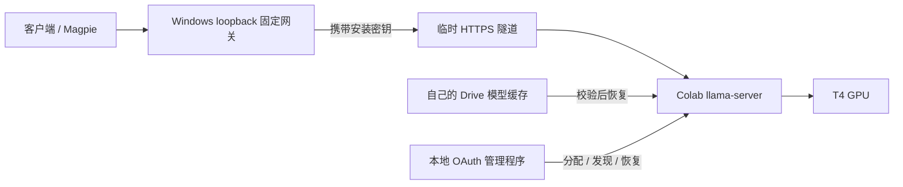

# Colab T4 部署历史与完整复刻索引

版本：2026-11-08。当前部署步骤以 [DEPLOYMENT.md](DEPLOYMENT.md) 为准，agent 约定见 [AGENTS.md](AGENTS.md)，修订验证见 [REVIEW.md](REVIEW.md)。本文件保留原部署的过程、取舍和实测，不能当成当前修订版的新账号验收证据。

## 目标与结构

在 Colab T4 运行 GGUF 模型，Windows 提供固定 OpenAI 兼容入口，Magpie 等客户端通过该入口调用。模型存入自己的 Drive，在临时 VM 变化后可恢复。

默认本地入口 `http://127.0.0.1:11435/v1`，模型 `deepseek-heretic-9b`。Magpie 可选，不是复刻核心服务的前置条件。Colab 不因此变成永久服务器，回收和恢复期间仍会中断。

## 原部署过程

1. 确认本地为 Intel Iris Xe 核显、32GB 内存，选择云端 T4 承担推理。
2. 检查 Google OAuth 和 Colab CLI，确认当前分发名为 `google-colab-cli`，不是 `colab-cli`。
3. 评估约 13.41GB 的 27B 量化模型后，改用约 5.63GB 的 9B Q4_K_M，为上下文与计算缓冲保留空间。
4. 获取官方 llama.cpp CUDA Linux 发布包，在 Colab 临时磁盘运行 llama-server。
5. 完成模型加载、预热及真实聊天，通过临时 HTTPS 隧道接入本地固定网关。
6. 将 Magpie 指向网关，完成实际客户端聊天。
7. 通过 Drive API 上传完整模型，并下载独立副本验证，避免把“授权成功”误判为“持久化成功”。
8. 从已工作脚本提取便携包，去除私人机器路径、账号、项目号和凭据。
9. 发布前审查暴露出鉴权、并发恢复、忙碌内核、进程清理、下载校验等缺陷；当前代码加入随机上游密钥、项目运行时识别、精确 PID/start-time 清理和离线测试。旧脚本的无鉴权、模拟保活和宽泛进程清理方式不属于当前复刻步骤。

## 原环境真实测量

这些数字属于历史特定环境，不是 SLA，也不是本次修订版实测。

| 项目 | 历史记录 |
| --- | --- |
| GPU | T4，15360 MiB |
| llama.cpp | b12202，CUDA 12.8 构建 |
| 上下文配置 | 131072 |
| 生成速度 | 约 33.8 tokens/s |
| 模型加载 | 约 90 秒 |
| 首次真实聊天 | 79.68 秒 |
| Magpie 后续请求 | 8.22 秒 |
| 不同提示后续请求 | 3.76 秒，返回 42 |
| Drive 独立完整恢复 | 约 9 分钟，原环境验证成功 |

首次部署还包括依赖、模型下载和服务加载，可能十几分钟或更久，取决于网络、GPU 分配与上游服务。不能只用文件大小估算最终可用时间。128K 上下文默认值也不保证任意实际长输入都能装进显存。

## 固定模型清单

| 项目 | 值 |
| --- | --- |
| 仓库 | `mradermacher/DeepSeek-V4-Pro-Qwen3.5-9B-UNCENSORED-heretic-i1-GGUF` |
| revision | `fff50f6bb44cefedd08217dbc285fb2c41213fff` |
| 文件 | `DeepSeek-V4-Pro-Qwen3.5-9B-UNCENSORED-heretic.i1-Q4_K_M.gguf` |
| bytes | `5629111584` |
| MD5 | `e241e16944eba37f2761f0d0b6e76acf` |
| SHA256 | `8cf793a36e62fb078ac05c2e1bdb2121ff94736dccbede7cf81b76346e868949` |

产品名称来自上游仓库，本项目未验证与其他同名模型的能力关系。权重和第三方软件不打包，使用条款见 THIRD_PARTY_NOTICES.md。

## 历史故障与结论

| 故障 | 当时处理和可复用结论 |
| --- | --- |
| GitHub 发布直链 504 | 改用官方 release asset API；仍需按校验值验收下载 |
| 原运行时消失，隧道 530 | 分辨 VM 回收与单纯隧道故障，在新运行时恢复模型 |
| 首次聊天慢 | 区分下载、加载、预热、首次推理和后续生成时间 |
| Jupyter `_manager` 析构 AttributeError | 不单凭本地析构错误断言远端部署失败，查实际健康与进程 |
| 管理 API 30 秒读超时 | 查询真实远端状态；执行超时不能立即重放部署 |
| Drive 授权正常但模型未持久化 | 实际上传并执行完整独立恢复后才验收 |
| SSH ProxyCommand 不稳定 | 最终采用 HTTPS 隧道，未继续把 SSH 当必需路径 |
| 假定 Ollama 二进制布局错误 | 改为明确官方 llama.cpp 发布资产 |
| KV 量化性能取舍 | 放弃当时收益不佳配置，以实际测量为准 |

## 当前验证边界

原环境的云端成功只证明历史方案在该环境可行。当前修订版仍需新主人完成本人 OAuth、Drive IAM/配额、GPU 分配、完整部署、真实聊天及恢复验证。离线单元测试、编译和发布扫描无法代替上述步骤。

复刻 agent 应逐项记录操作及退出码；对未运行的云端检查明确标注未验证。不要把本文件里的历史耗时、速度或成功结论复制进新环境的验收报告。
